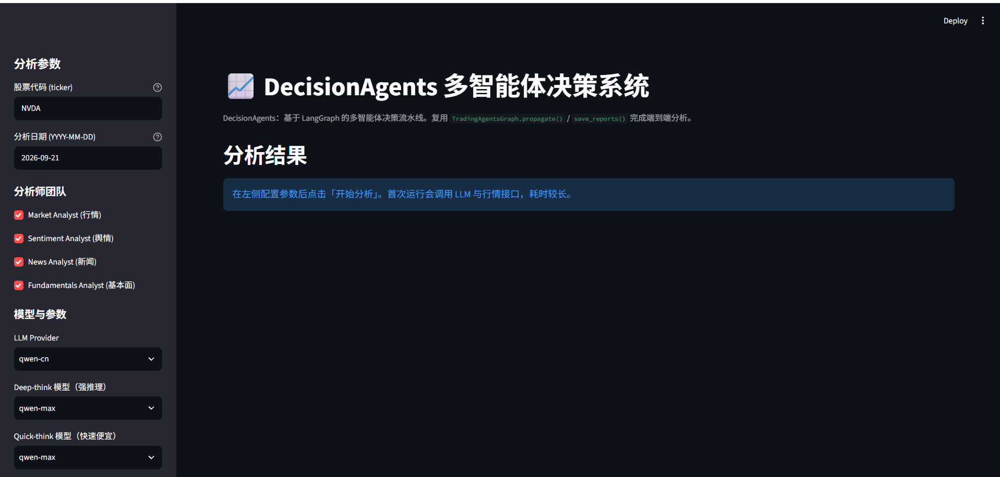
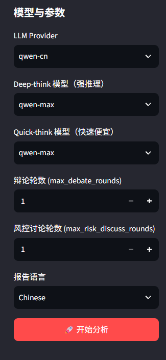
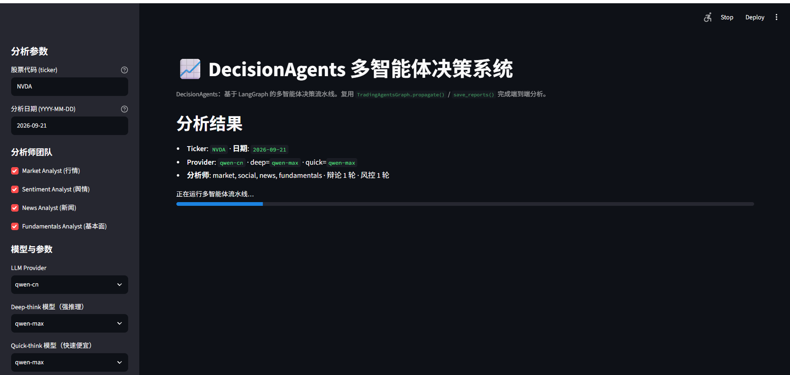
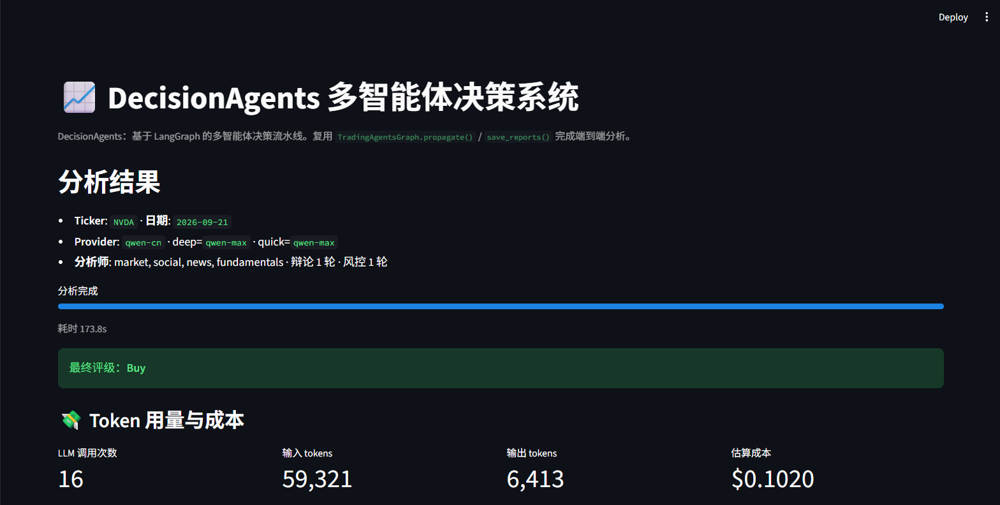
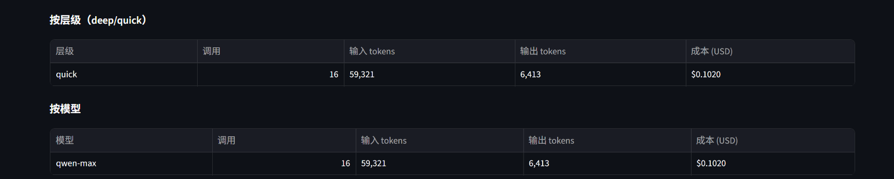
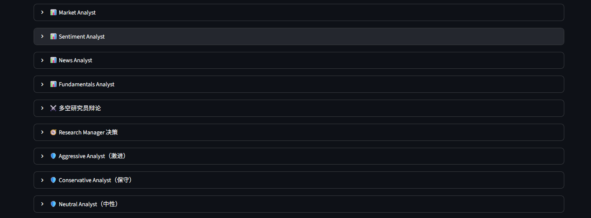
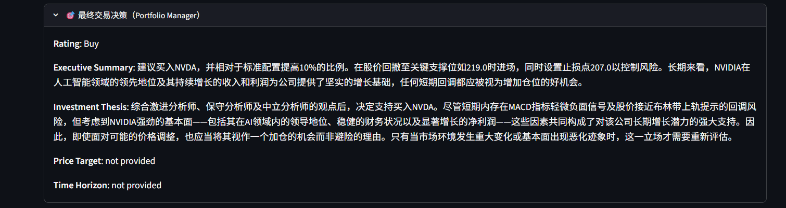

# DecisionAgents：多智能体 LLM 决策系统

DecisionAgents 是一个基于 [LangGraph](https://github.com/langchain-ai/langgraph) 的多智能体决策框架，模拟专业投研团队的协作流程。它部署一组各司其职的 LLM 智能体——分析师、研究员、交易员、风控团队与基金经理——通过结构化辩论协同评估市场状况并输出决策建议。

本仓库聚焦金融交易决策场景：分析师团队并行产出报告 → 多空研究员辩论 → 交易员拟定方案 → 风控三方辩论 → 基金经理最终决策。关键决策节点采用 Pydantic 结构化输出保证跨提供商一致性。核心流水线由 `TradingAgentsGraph` 驱动，可通过 Streamlit Web UI 或 Python API 调用。支持网格回测评估决策质量（实测 5 标的 × 20 交易日 = 100 个决策单元，总成本 $5.13），并通过记忆日志实现经验反思学习。

> DecisionAgents 仅用于研究目的。交易表现受所选基座模型、温度、交易周期、数据质量等多种非确定性因素影响，不构成任何金融、投资或交易建议。

## 界面预览

<p align="center">
  
</p>

## 架构

DecisionAgents 的流水线由 `TradingAgentsGraph` 驱动，依次经过以下阶段：

### 分析师团队

- **技术分析师**：利用技术指标（如 MACD 和 RSI）识别交易形态并预测价格走势。
- **舆情分析师**：聚合新闻标题、StockTwits 与 Reddit 讨论，经 TypeSafe Jev 社交帖文筛查后输出结构化情绪报告（SentimentReport），判断短期市场情绪。
- **新闻分析师**：监控全球新闻与宏观经济指标，解读事件对市场的影响。
- **基本面分析师**：评估公司财务与业绩指标，识别内在价值与潜在风险信号。

选中的分析师并行工作（`AnalystExecutionPlan` 管理执行计划），各自调用自己的工具，所有报告就绪后启动研究辩论。工具身份解析（`resolve_instrument_identity`）在运行开始时锚定真实公司身份，防止智能体从价格图表幻觉错误公司。

### 研究员团队

由多方（看多）与空方（看空）研究员组成，批判性地评估分析师团队提供的洞见。通过结构化辩论，在潜在收益与固有风险之间取得平衡。研究经理裁决辩论并输出结构化投资计划（ResearchPlan）。

### 交易员智能体

汇总分析师与研究员的报告，做出明智的交易决策，输出结构化交易提案（TraderProposal），包含交易方向、推理、入场价、止损和仓位建议。

### 风控与基金经理

- 风控团队由激进、保守、中性三方分析师组成，持续评估投资组合风险，向基金经理提供评估报告。
- 基金经理批准/否决交易提案，输出结构化最终决策（PortfolioDecision），包含五级评级、执行摘要、投资论点、目标价和时间范围。

### 结构化输出

关键决策节点（研究经理、交易员、基金经理、舆情分析师）采用 Pydantic 结构化输出：

- 优先使用提供商的原生结构化输出模式（OpenAI 的 `json_schema`、Gemini 的 `response_schema`、Anthropic 的 `tool-use`）
- Schema 字段描述作为模型的输出指令，提示词专注于上下文和评级指导
- `invoke_structured_or_freetext()` 统一调用模式：结构化调用失败时自动回退到自由文本，保证流水线不中断
- Render 函数将 Pydantic 实例转回 markdown，保持与报告、记忆日志和 Web UI 的兼容

### 投资组合上下文

可选传入 `PortfolioContext`（持仓、现金、货币），让智能体了解调用者的当前头寸。三种状态明确区分：有持仓、空仓、未提供——未提供不等于空仓，避免智能体对调用者账户做出无根据假设。组合指纹参与 checkpoint 签名，组合变更不会静默续跑旧状态。

## 安装

DecisionAgents 需要 Python 3.11 或更高版本。克隆本仓库并安装：

```bash
git clone <你的仓库地址>
cd DecisionAgents
pip install ".[ui]"          # 安装核心 + Streamlit Web UI
# 如需 Redis 缓存后端：pip install ".[ui,redis]"
```

## 快速开始

1. 复制示例环境文件并填入你的 API Key：

```bash
cp .env.example .env
```

2. 启动 Web UI：

```bash
streamlit run webapp.py
```

在浏览器中打开页面，选择分析师团队、配置模型与辩论轮数，点击「开始分析」即可运行完整流水线。

### 所需 API Key

本项目使用两家 LLM 提供商：**阿里云百炼 (DashScope)** 和 **DeepSeek**。阿里云百炼通过 OpenAI 兼容接口提供 16 家主流模型（通义千问、GLM 智谱、MiniMax 等），按需任选其一即可。

在 `.env` 中设置对应 API Key：

```bash
DEEPSEEK_API_KEY=...        # DeepSeek
DASHSCOPE_CN_API_KEY=...    # 阿里云百炼（中国区）
DASHSCOPE_API_KEY=...       # 阿里云百炼（国际区，可选）
```

数据源 API Key（按需配置）：

```bash
FRED_API_KEY=...            # FRED 宏观数据（免费，可选）
ALPHA_VANTAGE_API_KEY=...   # Alpha Vantage
TYPESAFE_API_KEY=...        # Jev 舆情筛查（可选）
```

## Web UI 说明

`webapp.py` 是一个轻量浏览器前端，直接复用 `TradingAgentsGraph.propagate()` 与 `save_reports()`，不重写任何分析逻辑。

### 参数面板

左侧参数面板包含：

- **股票代码 (ticker)**：如 `NVDA`、`0700.HK`、`600519.SS`，会自动归一化为 Yahoo Finance 格式（`normalize_symbol()`）。支持金属（XAUUSD→GC=F）、加密（BTCUSD→BTC-USD）、外汇（EURUSD→EURUSD=X）、港股补零（700.HK→0700.HK）、A 股后缀（600519.SH→600519.SS）等跨市场代码映射。
- **分析日期**：不能晚于今天；历史日期会触发 point-in-time 数据过滤。
- **分析师团队**：勾选参与本次运行的分析师（行情 / 舆情 / 新闻 / 基本面）。
- **模型与参数**：选择 LLM Provider、deep-think（强推理）与 quick-think（快速便宜）模型、辩论轮数与风控讨论轮数、报告语言。
- **投资组合（可选）**：传入 JSON 格式的持仓信息，让智能体了解当前头寸。

<p align="center">
  
</p>

### 运行过程

点击「开始分析」后，页面会展示本次运行的配置摘要（Ticker、日期、Provider、模型、分析师、辩论/风控轮数），并显示进度条：

<p align="center">
  
</p>

### 运行结果

分析完成后，结果区依次展示：

**1. 最终评级徽章与 Token/成本看板**

<p align="center">
  
</p>

成本看板按层级（deep/quick）和按模型分别统计调用次数、输入/输出 tokens 与估算成本：

<p align="center">
  
</p>

**2. 分析师报告与辩论过程**

各分析师报告、多空研究员辩论、研究经理决策、风控三方辩论均以可折叠面板形式展示：

<p align="center">
  
</p>

**3. 最终交易决策**

基金经理输出包含 Rating、Executive Summary、Investment Thesis、Price Target、Time Horizon 等字段的最终决策：

<p align="center">
  
</p>

## 配置参考

所有配置项可通过 `DEFAULT_CONFIG`（`tradingagents/default_config.py`）或 `TRADINGAGENTS_*` 环境变量覆盖。常用配置：

| 配置键 | 环境变量 | 说明 |
|---|---|---|
| `llm_provider` | `TRADINGAGENTS_LLM_PROVIDER` | LLM 提供商（`deepseek` / `qwen-cn` / `qwen`），默认 `qwen-cn` |
| `deep_think_llm` | `TRADINGAGENTS_DEEP_THINK_LLM` | 强推理模型 ID |
| `quick_think_llm` | `TRADINGAGENTS_QUICK_THINK_LLM` | 快速便宜模型 ID |
| `max_debate_rounds` | `TRADINGAGENTS_MAX_DEBATE_ROUNDS` | 多空辩论最大轮数 |
| `max_risk_discuss_rounds` | `TRADINGAGENTS_MAX_RISK_DISCUSS_ROUNDS` | 风控辩论最大轮数 |
| `output_language` | `TRADINGAGENTS_OUTPUT_LANGUAGE` | 报告语言（English / Chinese） |
| `cache_backend` | `TRADINGAGENTS_CACHE_BACKEND` | `disk`（默认，零依赖）或 `redis` |
| `cache_enabled` | `TRADINGAGENTS_CACHE_ENABLED` | `false` 整体关闭缓存 |
| `redis_url` | `TRADINGAGENTS_REDIS_URL` | Redis 后端连接串 |
| `cache_ttl` | `TRADINGAGENTS_CACHE_TTL` | 缓存有效期（秒），`None` 表示永不过期 |
| `data_vendors` | `TRADINGAGENTS_DATA_VENDORS` | 数据厂商主备链，默认 `yfinance,alpha_vantage` |
| `checkpoint_enabled` | `TRADINGAGENTS_CHECKPOINT_ENABLED` | `true` 启用 SQLite 断点续跑 |
| `holding_period_days` | `TRADINGAGENTS_HOLDING_PERIOD_DAYS` | 决策持有期天数（默认 5），用于结算收益 |
| `benchmark_ticker` | `TRADINGAGENTS_BENCHMARK_TICKER` | 收益对比基准（默认按区域自动选择） |
| `cost_price_table` | — | 按模型覆盖价格（如免费额度模型设为 0） |

### 市场与代码

- 美股：`AAPL`、`SPY`
- 港股：`0700.HK` · 日股：`7203.T` · 英股：`AZN.L`
- 印度：`RELIANCE.NS`、`.BO` · 加拿大：`.TO` · 澳洲：`.AX`
- A 股：沪市 `.SS`、深市 `.SZ`（如 `600519.SS`）
- 加密：`BTC-USD`、`ETH-USD`
- 金属：`XAUUSD`（黄金，自动映射为 `GC=F`）、`XAGUSD`（白银→`SI=F`）
- 能源：`WTICOUSD`（原油→`CL=F`）、`NATGAS`（天然气→`NG=F`）
- 指数：`SPX500`（→`^GSPC`）、`NAS100`（→`^NDX`）、`JP225`（→`^N225`）
- 外汇：`EURUSD`（→`EURUSD=X`）

## Python API

核心入口为 `TradingAgentsGraph.propagate()`：

```python
from tradingagents.graph.trading_graph import TradingAgentsGraph
from tradingagents.default_config import DEFAULT_CONFIG

config = DEFAULT_CONFIG.copy()
config["llm_provider"] = "qwen-cn"          # 国产模型示例（DashScope 中国区）
config["deep_think_llm"] = "qwen-plus"      # 强推理模型
config["quick_think_llm"] = "qwen-flash"    # 快速便宜模型

ta = TradingAgentsGraph(debug=True, config=config)
state, decision = ta.propagate("NVDA", "2026-09-01")
print(decision)
ta.save_reports(state, "NVDA")
```

### 带投资组合的分析

```python
from tradingagents.portfolio import PortfolioContext, Position

portfolio = PortfolioContext(
    cash=100000.0,
    currency="USD",
    positions=[
        Position(ticker="NVDA", quantity=100, average_price=120.5),
        Position(ticker="AAPL", quantity=50, average_price=180.0),
    ],
)

state, decision = ta.propagate("NVDA", "2026-09-01", portfolio=portfolio)
```

### 网格回测

```python
from tradingagents.backtest import run_backtest, summarize, iter_grid

dates = iter_grid("2026-01-01", "2026-03-31", every_n_days=7)
result = run_backtest(
    tickers=["AAPL", "MSFT", "GOOGL"],
    dates=dates,
    config=config,
)
summary = summarize(result)
print(summary.render())
```

回测系统遍历 ticker × date 网格，每个单元格独立运行并记录到独立记忆日志。`summarize()` 按评级评分：Buy/Overweight 期望 alpha > 0，Sell/Underweight 期望 alpha < 0，Hold 无方向。输出每评级的样本数、命中率和平均 alpha。已运行单元格自动跳过，支持断点续跑。

#### 实测回测结果

5 标的（AAPL, MSFT, GOOGL, TSLA, AMZN）× 20 交易日（2025-09-01 至 2025-09-26），模型 qwen-plus (deep) + qwen-flash (quick)，基准 SPY，持有期 5 个交易日：

| 指标 | 数值 |
|---|---|
| 决策单元 | 100 个（95 已结算，5 个 REVIEW 未评分） |
| 总成本 | $5.13 USD |
| LLM 调用 | 2,400 次（deep 960 次 / quick 1,440 次） |
| Token 消耗 | 2,538 万（输入 2,176 万 + 输出 362 万） |
| 耗时 | ~3.4 小时 |
| 单次运行 | ~$0.05 / ~25.4 万 tokens |

按评级评分：

| 评级 | 样本数 | 命中率 | 平均 alpha vs SPY |
|---|---|---|---|
| Hold | 30 | —（无方向声明） | +0.06% |
| Buy | 28 | 50% | +0.00% |
| Overweight | 19 | 47% | +0.14% |
| Underweight | 14 | 64% | -0.47% |
| Sell | 4 | 50% | -1.42% |

按标的：MSFT 表现最佳（mean alpha +0.54%），TSLA 最差（-0.89%）。

### 双层响应缓存

`tradingagents/cache.py` 提供统一的 `ResponseCache` 门面，支持 `disk`（默认 JSON 文件，零依赖）与 `redis`（需 `decisionagents[redis]`）两种后端，对外暴露一致的 `get/set/clear/clear_scope` 接口。缓存 key 为 `namespace:version:sha256`，`llm:` 与 `data:` 分层可独立清理，命中即免费。

### 全链路 LLM 成本核算

`tradingagents/cost_tracker.py` 逐轮调用记账（provider/model/tier/输入输出 tokens/时延/估算成本），价格表集中在 `tradingagents/llm_clients/model_catalog.py`。每次运行在报告目录下写 `cost_report.json`，Web UI 内可视化。可通过 `cost_price_table` 按模型覆盖价格：

```python
config = DEFAULT_CONFIG.copy()
config["cost_price_table"] = {"qwen-flash": {"input": 0.0, "output": 0.0}}
```

## 持久化与恢复

### 记忆日志

每次运行会把决策追加到 `~/.tradingagents/memory/trading_memory.md`，下次分析同一标的时会注入已实现收益的复盘反思。历史/回测运行使用 point-in-time 过滤（`as_of=trade_date`），只注入在分析日期前已结算的反思，保证不回溯未来信息。可用 `TRADINGAGENTS_MEMORY_LOG_PATH` 覆盖路径。

### 断点续跑

`TradingAgentsGraph` 支持 SQLite checkpointer 断点续跑，避免中途失败后从头重跑。运行签名（analysts/debate/risk/asset/portfolio/settings 的 SHA256）保证配置变更后不会静默续跑旧状态。可通过 `checkpoint_scope` / `begin_checkpoint` 管理 checkpoint 生命周期。

## 可复现性

DecisionAgents 由 LLM 驱动，同一标的同一日期两次运行结果可能不同——这是研究型工具的正常现象，并非缺陷。要减少波动，可降低 `temperature`，并在 `deep_think_llm` / `quick_think_llm` 中指定非推理模型。
